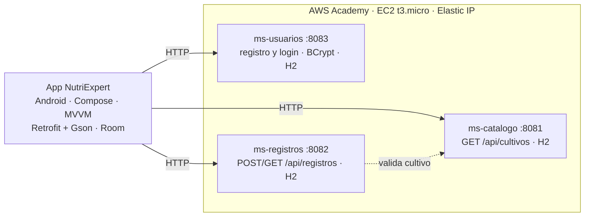

# nutriexpert-backend

Microservicios Spring Boot que consume la app Android **NutriExpert** con Retrofit.

| Servicio | Puerto | Qué hace |
|---|---|---|
| `ms-catalogo` | 8081 | Lista de cultivos y sus valores base de nutrientes |
| `ms-registros` | 8082 | Recibe y guarda los registros de terreno que la app sincroniza |
| `ms-usuarios` | 8083 | Registro y login de usuarios (clave con BCrypt) |

> Los valores de los cultivos son **de demostración**, no recomendaciones agronómicas.
> Todos los usuarios y claves de ejemplo son **ficticios**.

## Arquitectura



Cada servicio tiene la misma estructura en capas:

```
ms-xxx/src/main/java/cl/duoc/nutriexpert/xxx/
├── controller/   @RestController + ManejadorErrores (@RestControllerAdvice)
├── service/      lógica de negocio
├── repository/   JpaRepository
├── model/        @Entity
└── exception/    errores que se traducen a 400 / 401 / 404 / 409
```

Stack: Java 17, Spring Boot 3.5, Maven, Spring Web, Spring Data JPA, Validation, H2 en archivo.
`ms-usuarios` agrega `spring-security-crypto` (solo `BCryptPasswordEncoder`, sin Spring Security completo).

## Cómo levantarlo en local

Requisito: Java 17 o superior (`java -version`). No hace falta instalar Maven: `./mvnw` lo descarga la primera vez.

```bash
# Los tres a la vez (Ctrl+C los detiene)
./levantar-local.sh

# O uno por uno, cada uno en su terminal
cd ms-catalogo  && ./mvnw spring-boot:run
cd ms-usuarios  && ./mvnw spring-boot:run
cd ms-registros && ./mvnw spring-boot:run
```

Comprobar: `curl http://localhost:8081/api/cultivos` devuelve los 3 cultivos.

- Las bases H2 quedan en la carpeta `data/` de cada servicio y sobreviven a un reinicio. Para partir de cero, borra esa carpeta.
- Consola H2: `http://localhost:808X/h2-console` (usuario `sa`, sin clave, JDBC URL `jdbc:h2:file:./data/<servicio>`).
- `ms-usuarios` crea al partir el usuario de demostración `demo@nutriexpert.cl` / `ClaveDemo123` (se desactiva con `usuarios.demo.crear=false`).
- Desde el emulador de Android, `localhost` del computador es `10.0.2.2`.

### Pruebas unitarias

```bash
cd ms-catalogo  && ./mvnw test
cd ms-registros && ./mvnw test
cd ms-usuarios  && ./mvnw test
```

Son pruebas de la capa `service` con JUnit 5 y Mockito (el repositorio se simula).

### Postman

Importa `postman/nutriexpert.postman_collection.json`. La variable de colección `host` vale `localhost`; cámbiala por la Elastic IP para probar en EC2. Cada request trae tests que verifican el código de respuesta. Con *Run collection* se prueban todos en orden.

## Endpoints

Todas las respuestas de error tienen la forma `{ "error": "mensaje" }`.

### ms-usuarios (8083)

| Método | Ruta | Respuesta |
|---|---|---|
| POST | `/api/usuarios/registro` | 201 + usuario sin clave · 400 datos inválidos · 409 correo ya existe |
| POST | `/api/usuarios/login` | 200 + usuario · 401 `"Correo o clave incorrectos"` |
| GET | `/api/usuarios/{id}` | 200 · 404 |

Reglas: correo con formato válido y guardado en minúsculas, clave de 8 a 72 caracteres, rol `AGRICULTOR` o `ASESOR`. La clave se guarda con BCrypt y nunca sale en una respuesta (se usa el DTO `UsuarioResponse`). El login fallido responde siempre lo mismo, exista o no el correo.

```json
POST /api/usuarios/login
{ "correo": "demo@nutriexpert.cl", "clave": "ClaveDemo123" }

200 → { "id": 1, "nombre": "Usuario Demo", "correo": "demo@nutriexpert.cl", "rol": "AGRICULTOR" }
401 → { "error": "Correo o clave incorrectos" }
```

### ms-catalogo (8081)

| Método | Ruta | Respuesta |
|---|---|---|
| GET | `/api/cultivos` | 200 + lista |
| GET | `/api/cultivos/{id}` | 200 · 404 |
| POST | `/api/cultivos` | 201 + cultivo · 400 · 409 nombre repetido |

```json
GET /api/cultivos → 200
[ { "id": 1, "nombre": "Palto", "rendimientoBase": 10.0,
    "n": 60.0, "p2o5": 20.0, "k2o": 80.0, "cao": 30.0, "mgo": 15.0 } ]
```

`data.sql` carga Palto, Cítricos y Tomate (los mismos de `DatosEjemplo.kt` de la app) con `MERGE`, así que se puede ejecutar en cada arranque sin duplicar.

### ms-registros (8082)

| Método | Ruta | Respuesta |
|---|---|---|
| POST | `/api/registros` | 201 + registro con `id` · 200 si ya existía · 400 |
| GET | `/api/registros?usuarioId={id}` | 200 + lista |
| GET | `/api/registros/{id}` | 200 · 404 |
| DELETE | `/api/registros/{id}` | 204 · 404 |

```json
POST /api/registros
{ "idLocal": 7, "usuarioId": 1, "cultivo": "Palto", "lote": "L-01",
  "metaRendimiento": 12.0, "eficienciaRiego": 85.0,
  "n": 84.7, "p2o5": 28.2, "k2o": 112.9, "cao": 42.4, "mgo": 21.2,
  "creadoEn": 1795600000000 }

201 → el mismo objeto más "id": 15
400 → { "error": "eficienciaRiego debe estar entre 1 y 100" }
```

Reglas:
- Validación con `@Valid`: lote y cultivo no vacíos, `eficienciaRiego` entre 1 y 100, nutrientes ≥ 0.
- **Sin duplicados:** `usuarioId + idLocal` es único. Si la app reenvía un registro, se devuelve el que ya existe (200). Reintentar la sincronización es seguro.
- El cultivo se valida contra `ms-catalogo`. Si `ms-catalogo` no responde, el registro se acepta igual para no bloquear la sincronización (queda en el log).
- La foto no se envía: queda solo en el teléfono.

## Despliegue en AWS Academy (EC2)

1. Learner Lab → **Start Lab** → consola de AWS.
2. EC2 → lanzar **Amazon Linux 2023**, **t3.micro**, key pair **vockey** (la llave `labsuser.pem` se descarga en *AWS Details*).
3. Security group: puerto **22** solo desde tu IP; **8081, 8082 y 8083** desde cualquier lugar.
4. Asignar una **Elastic IP** a la instancia.
5. Instalar Java, swap y los servicios `systemd` (una sola vez):
   ```bash
   chmod 400 labsuser.pem
   scp -i labsuser.pem -r deploy ec2-user@<elastic-ip>:~
   ssh -i labsuser.pem ec2-user@<elastic-ip> 'bash ~/deploy/instalar-en-ec2.sh'
   ```
6. Compilar y subir los `.jar` (cada vez que cambie el código):
   ```bash
   ./deploy/subir-jars.sh <elastic-ip> labsuser.pem
   ```
7. Probar: `http://<elastic-ip>:8081/api/cultivos` en Postman o el navegador.
8. En la app: cambiar `HOST` en `RetrofitInstance.kt` y la IP en `res/xml/network_security_config.xml`.

Ver logs en la instancia: `journalctl -u ms-registros -f`.

**Cuidados del Learner Lab:** la sesión dura unas 4 horas y luego detiene la instancia (sin borrarla). Antes de cada demo, *Start Lab* y esperar ~3 minutos a que los servicios levanten (arrancan solos por `systemd`). Detener el lab cuando no se use. Nunca subir la llave `.pem` ni contraseñas al repositorio (ya están en `.gitignore`).

## Decisiones y limitaciones

- **Sin tokens (decisión consciente):** `ms-registros` confía en el `usuarioId` que envía la app. Es aceptable para una demo con datos ficticios. La mejora sería que `ms-usuarios` entregue un JWT en el login, que la app lo envíe en `Authorization: Bearer` con un interceptor de Retrofit y que los otros servicios lo validen.
- **HTTP sin TLS:** la app permite tráfico en claro solo hacia la IP del servidor (`network_security_config`). En producción se pondría HTTPS (por ejemplo, un balanceador con certificado).
- **H2 en archivo:** suficiente para la evaluación. Para MySQL/RDS basta cambiar `spring.datasource.*` en `application.properties` y agregar el driver al `pom.xml`.
- **Usuario demo:** su clave está en `application.properties` porque es ficticia y sirve para el contrato de ejemplo. No usar claves reales.
